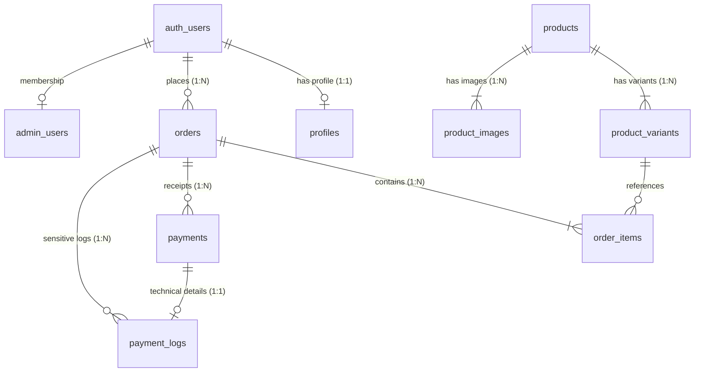

# FORME DENIM — Database Architecture Specification
**Database:** Supabase PostgreSQL  
**Version:** 1.2.1 (Hardened Pre-Deployment Schema)  
**Target Currency:** LKR (Sri Lankan Rupee)

---

## 1. Architectural Design & Monetary Precision

### Safe Numeric Currency Representation (`NUMERIC(12, 2)`)
* **Eliminating Floating-Point Inaccuracies:**  
  Standard `FLOAT` / `DOUBLE PRECISION` binary types cause representation anomalies (e.g., `0.1 + 0.2 = 0.30000000000000004`). In e-commerce, accumulating decimal drift leads to receipt discrepancies, balance audit mismatches, and PayHere payment hash failures.
* **Exact Decimal Matching for PayHere:**  
  Sri Lankan bank processors and the PayHere Gateway expect two-decimal currency values (`24500.00`). PostgreSQL's `NUMERIC(12, 2)` performs exact decimal math (up to 10 integer digits and 2 decimal places = max LKR 9,999,999,999.99), completely eliminating rounding anomalies without requiring constant division by 100 in database queries.

---

## 2. Entity-Relationship Overview



### Table Relationships & Key Safeguards

1. **`auth.users` ↔ `public.profiles` (1 : 1)**
   * `profiles.id` is both Primary Key and Foreign Key referencing `auth.users(id) ON DELETE CASCADE`.
   * Automatically provisioned by the error-resilient `handle_new_user()` trigger on signup.

2. **`auth.users` ↔ `public.admin_users` (1 : 1 optional)**
   * Separate protected authorization table.
   * `is_admin()` Security Definer function checks membership without exposing the table to public inspection.

3. **`public.products` ↔ `public.product_variants` (1 : N)**
   * Master product styles (e.g., *The 01 Selvedge Straight*) linked to purchasable SKUs (e.g., *Size 30, SKU: FD-01-RAW-30*).
   * `UNIQUE(product_id, size_label)` prevents duplicate sizes under the same product.

4. **`public.products` ↔ `public.product_images` (1 : N)**
   * Stores CDN paths / Supabase Storage links, display order, and alt text.
   * `UNIQUE(product_id, image_url)` prevents duplicate image rows.

5. **`public.orders` ↔ `public.order_items` (1 : N)**
   * `order_items.product_variant_id` uses `ON DELETE SET NULL`: If a variant or product is decommissioned in the future, past order records and receipts remain completely intact.
   * Historical snapshots (`product_name_snapshot`, `sku_snapshot`, `unit_price_snapshot`, `line_total`) are stored immutably.

6. **`public.orders` ↔ `public.payments` ↔ `private.payment_gateway_logs`**
   * **`payments` (Customer-Facing):** Safe receipt data (`provider`, `provider_transaction_id`, `status`, `amount`, `payment_method`).
   * **`private.payment_gateway_logs` (Backend Service Role ONLY):** Raw gateway webhooks, verification checksums, card tokens, IP addresses. Completely isolated in a private schema unexposed to PostgREST.

---

## 3. Atomic Inventory Handling Strategy

During high-traffic product drops, multiple customers may attempt to purchase the last available pair of jeans simultaneously. 

### Checkout Reservation Strategy:
Instead of standard non-atomic `SELECT stock -> IF stock > 0 -> UPDATE stock` (which allows race conditions and negative inventory), checkout executes an atomic decrement in a database function:

```sql
UPDATE public.product_variants
SET stock_quantity = stock_quantity - requested_quantity
WHERE id = target_variant_id 
  AND stock_quantity >= requested_quantity
RETURNING stock_quantity;
```

* If the row count returned is `0`, stock was insufficient and the checkout transaction immediately aborts with an `"Insufficient Stock"` notice.
* Combined with the table-level constraint `CHECK (stock_quantity >= 0)`, inventory can never underflow.

---

## 4. Row Level Security (RLS) Policy Matrix

| Table | Operation | Role | Policy Condition |
| :--- | :--- | :--- | :--- |
| **`products`** | `SELECT` | `anon` | `is_active = true` (Isolated from `is_admin()`) |
| **`products`** | `SELECT` | `authenticated` | `is_active = true OR is_admin()` |
| **`products`** | `INSERT / UPDATE / DELETE` | `authenticated` | `is_admin()` |
| **`product_variants`** | `SELECT` | `anon` | `is_active = true AND parent product is_active = true` |
| **`product_variants`** | `SELECT` | `authenticated` | `(is_active = true AND parent is_active = true) OR is_admin()` |
| **`product_variants`** | `INSERT / UPDATE / DELETE` | `authenticated` | `is_admin()` |
| **`product_images`** | `SELECT` | `anon` | Belongs to active product (`EXISTS parent is_active = true`) |
| **`product_images`** | `SELECT` | `authenticated` | Belongs to active product OR `is_admin()` |
| **`product_images`** | `INSERT / UPDATE / DELETE` | `authenticated` | `is_admin()` |
| **`profiles`** | `SELECT` | `authenticated` | `auth.uid() = id OR is_admin()` |
| **`profiles`** | `UPDATE` | `authenticated` | `auth.uid() = id` (can only edit own profile) |
| **`orders`** | `SELECT` | `authenticated` | `auth.uid() = customer_id OR is_admin()` |
| **`orders`** | `INSERT` | `service_role` | **Locked to serverless backend** (*Zero client insertion*) |
| **`orders`** | `UPDATE` | `authenticated` | `is_admin()` only (*restricted to fulfillment columns*) |
| **`order_items`** | `SELECT` | `authenticated` | Order belongs to user (`auth.uid() = o.customer_id`) |
| **`order_items`** | `INSERT / UPDATE / DELETE` | `service_role` | Locked to serverless backend |
| **`payments`** | `SELECT` | `authenticated` | Order belongs to user (`auth.uid() = o.customer_id`) |
| **`payments`** | `INSERT / UPDATE / DELETE` | `service_role` | Locked to PayHere webhook handler |
| **`private.payment_gateway_logs`** | `SELECT / ALL` | `service_role` | **Locked to private schema** (*Zero client access*) |
| **`admin_users`** | `SELECT` | `authenticated` | `is_admin()` |
| **`admin_users`** | `INSERT / UPDATE / DELETE` | `service_role` | Cannot be self-assigned by clients |

---

## 5. Explicit Least-Privilege Permissions Matrix

To prevent reliance on default PostgreSQL or Supabase role privileges, the migration explicitly revokes all privileges and grants only the minimum operations required for each role. Catastrophic `TRUNCATE` is strictly revoked from all roles, including `service_role`:

| Table | `anon` | `authenticated` | `service_role` | `TRUNCATE` Allowed |
| :--- | :--- | :--- | :--- | :--- |
| `public.products` | `SELECT` | `SELECT, INSERT, UPDATE, DELETE` (RLS protected) | `SELECT, INSERT, UPDATE, DELETE, REFERENCES, TRIGGER` | **NONE (REVOKED)** |
| `public.product_variants` | `SELECT` | `SELECT, INSERT, UPDATE, DELETE` (RLS protected) | `SELECT, INSERT, UPDATE, DELETE, REFERENCES, TRIGGER` | **NONE (REVOKED)** |
| `public.product_images` | `SELECT` | `SELECT, INSERT, UPDATE, DELETE` (RLS protected) | `SELECT, INSERT, UPDATE, DELETE, REFERENCES, TRIGGER` | **NONE (REVOKED)** |
| `public.profiles` | *None* | `SELECT, UPDATE` (RLS protected) | `SELECT, INSERT, UPDATE, DELETE, REFERENCES, TRIGGER` | **NONE (REVOKED)** |
| `public.admin_users` | *None* | `SELECT` (RLS protected) | `SELECT, INSERT, UPDATE, DELETE, REFERENCES, TRIGGER` | **NONE (REVOKED)** |
| `public.orders` | *None* | `SELECT, UPDATE (order_status, customer_notes, shipping_address, updated_at)` | `SELECT, INSERT, UPDATE, DELETE, REFERENCES, TRIGGER` | **NONE (REVOKED)** |
| `public.order_items` | *None* | `SELECT` (RLS protected) | `SELECT, INSERT, UPDATE, DELETE, REFERENCES, TRIGGER` | **NONE (REVOKED)** |
| `public.payments` | *None* | `SELECT` (RLS protected) | `SELECT, INSERT, UPDATE, DELETE, REFERENCES, TRIGGER` | **NONE (REVOKED)** |
| `private.payment_gateway_logs` | *None* | *None* | `SELECT, INSERT, UPDATE, DELETE, REFERENCES, TRIGGER` | **NONE (REVOKED)** |

---

## 6. Order Fulfillment Integrity & Trigger Protection

To prevent authorized administrators or authenticated clients from altering financial totals or payment status directly:
1. **Column-Level Grant Restriction:**  
   `authenticated` users only hold `UPDATE` permissions on `(order_status, customer_notes, shipping_address, updated_at)`. Any query attempting to update `subtotal`, `total_amount`, `shipping_fee`, `currency`, `customer_id`, `order_number`, or `payment_status` is rejected at query planning (`SQLSTATE 42501`).
2. **Defensive Trigger Safeguard (`trg_protect_order_financial_fields`):**  
   A `BEFORE UPDATE` trigger on `public.orders` executing with `SECURITY INVOKER` and `SET search_path = ''` verifies that non-`service_role` actors cannot modify any financial field, customer identifier, or payment status under any circumstance.
3. **Backend Service Role Exemption:**  
   The trigger checks `IF (CURRENT_USER = 'service_role') THEN RETURN NEW; END IF;`. Effective database authorization enables the backend serverless order creation endpoint (`/api/orders/create`) and PayHere webhook handler to legitimately update financial balances and confirm payment settlements.

---

## 7. Seed Architecture & Clean Deployment Workflow

* **Separation of DDL and Test Data:**  
  The sample catalog has been extracted from the migration stream into `supabase/seed.sql`.
* **Zero Contamination in Production:**  
  When executing `supabase db push` against staging or production environments, only versioned DDL migrations in `supabase/migrations/` are applied.
* **Idempotent Local Seeding:**  
  During local resets (`supabase db reset`), `supabase/seed.sql` populates development catalog fixtures idempotently with `ON CONFLICT DO NOTHING`, guaranteeing that test prices and inventory are never accidentally overwritten.

---

## 8. Automated Verification Suite (`supabase/tests/rls_test.sql`)

The pgTAP automated test suite runs **46 automated assertions** across 5 testing suites inside an atomic transaction that rolls back cleanly:
* **Suite 1: Anonymous Visitor Verification (5 assertions)** — Active catalog discovery, draft product invisibility, private schema isolation, zero client order insertion.
* **Suite 2: Authenticated Customer Privacy & Tamper-Resistance (11 assertions)** — Cross-tenant isolation, price immutability, inventory stock immutability, fake payment rejection, zero direct order insertion.
* **Suite 3: Store Administrator Operations & Restrictions (12 assertions)** — Draft Jeans visibility, full order fulfillment visibility, base price updating, stock adjustment, fulfillment status updating, rejection of direct total_amount and payment_status updates.
* **Suite 4: Backend Service Role Operations (4 assertions)** — Verifies that `service_role` can legitimately update protected `total_amount` and `payment_status` fields for order settlement.
* **Suite 5: Least-Privilege Table & Column Privileges Audit (14 assertions)** — Disablement of TRUNCATE across all application tables for `anon`, `authenticated`, and `service_role`; absence of INSERT/DELETE on orders for client roles; column-level UPDATE enforcement.
